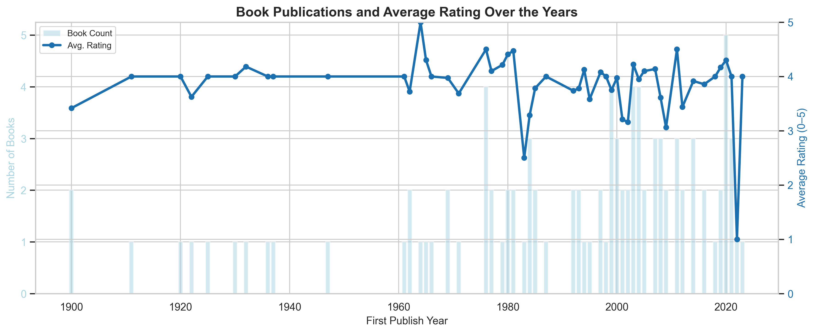
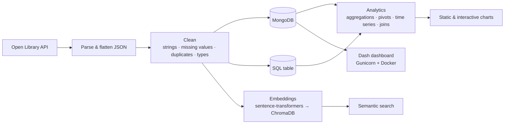
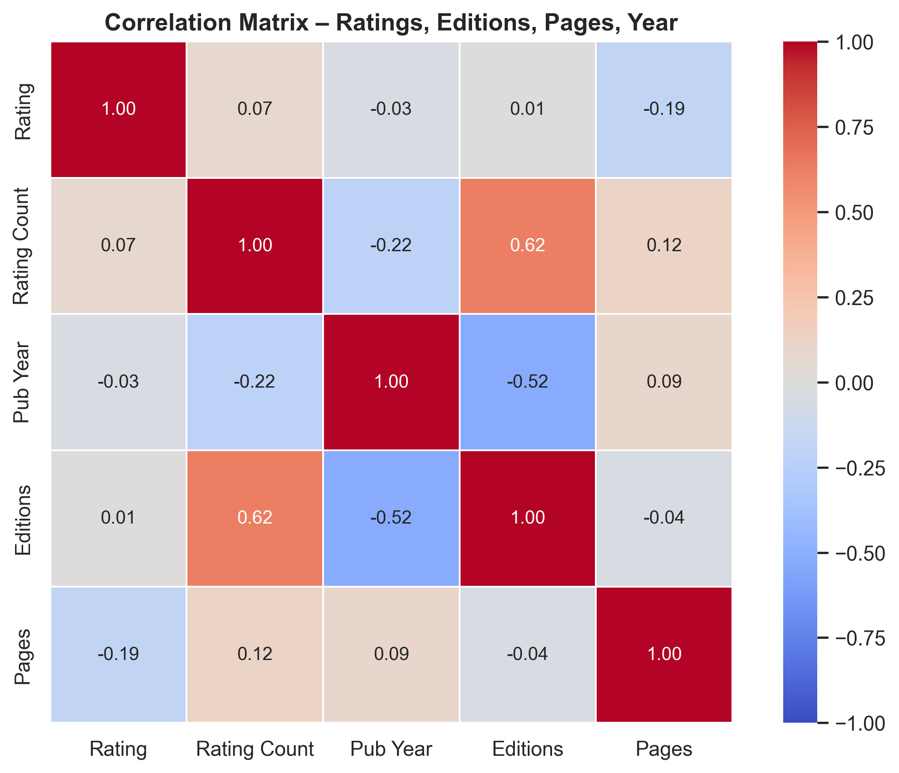

# Book Data Pipeline & Analytics Dashboard


An end-to-end data pipeline that collects book data from the **Open Library API**, cleans it, stores it in **MongoDB**, analyses it with **pandas** and SQL, supports **semantic and hybrid search** over the books with sentence embeddings and **ChromaDB**, and serves the results in an interactive **Dash** dashboard deployed with **Docker Compose**.

It also includes modules for unstructured file types: parsing PDF, Word and Excel documents, and processing images, audio and video (including speech-to-text with Whisper).



## Pipeline



## Key findings

Based on a sample of 100 books returned by Open Library for the query "dune" (first published 1893–2023, 56 distinct subjects):

- **Popular books get reprinted.** The number of editions is strongly correlated with the number of ratings (**r = 0.62**). Older books also tend to have more editions (**r = −0.52** with publication year).
- **Longer isn't better.** Page count has only a weak negative correlation with average rating (**r = −0.19**).
- **Ratings are sparse.** **29%** of books have no rating count, which the cleaning step has to handle before any averages are computed.
- **One book dominates engagement.** *Dune* (Frank Herbert) has 414 ratings with a 4.30 average, more than three times the next most-rated book, *Dune Messiah* (132).



## Features

| Area | What it does | Code |
|---|---|---|
| Ingestion | Paginated Open Library search with retries; maps nested API records to flat rows | `src/api`, `src/parsing/parsers.py` |
| Documents | Extracts text and tables from PDF, Word and Excel files | `src/parsing` |
| Cleaning | Whitespace/casing fixes, regex cleaning, missing-value handling, de-duplication, type conversion, validation | `src/cleaning` |
| Storage | MongoDB (pymongo) and S3-compatible object storage (boto3, tested against LocalStack) | `src/storage` |
| Analytics | MongoDB aggregation pipelines, joins between a SQL table and MongoDB data (inner/outer/left/right), pivot/melt reshaping, yearly resampling and rolling averages | `src/analytics` |
| Semantic search | Sentence-transformer embeddings stored in ChromaDB; cosine, dot-product and Euclidean similarity; hybrid keyword + semantic search merged with Reciprocal Rank Fusion | `src/embeddings` |
| Media | Image resizing/cropping/thumbnails/EXIF; audio trimming and conversion; video keyframes and Whisper transcription | `src/image_processing`, `src/audio_processing`, `src/video_processing` |
| Visualisation | Matplotlib/Seaborn static charts and Plotly interactive charts | `src/visualization`, `outputs/visualizations` |
| Dashboard | Dash app with KPI cards, filters (subject, year range, title search), four linked charts and a live ticker; reads from MongoDB and falls back to CSV | `app.py`, `src/dashboard` |

## Getting started

Requires Python 3.11+.

```bash
git clone https://github.com/AbduBes/Unstructured-Data-Project.git
cd Unstructured-Data-Project
python -m venv .venv && source .venv/bin/activate   # Windows: .venv\Scripts\activate
pip install -r requirements.txt
cp .env.example .env    # only needed for the Google Drive upload utilities
```

**Run the pipeline.** This fetches the data, cleans it, runs the analytics and generates the charts. Output goes to `data/`, which is not committed.

```bash
python src/pipeline/run_pipeline.py
```

**Run the dashboard locally.** Then open http://127.0.0.1:8050.

```bash
python app.py
```

**Run the dashboard with Docker.** This starts the dashboard and MongoDB together.

```bash
docker compose up --build
python scripts/seed_mongo.py      # one-time: load the cleaned data into MongoDB
# open http://localhost:8050
docker compose down               # add -v to also delete the MongoDB volume
```

## Tests

Unit tests cover the API record parsing, the cleaning steps and the dashboard's data-access and filtering logic. They run automatically on every push through GitHub Actions.

```bash
pip install pytest
pytest -v
```

## Project structure

```
├── app.py                  # Dash entry point (exposes `server` for Gunicorn)
├── src/
│   ├── api/                # Open Library client
│   ├── parsing/            # JSON, PDF, Word, Excel parsers
│   ├── cleaning/           # cleaning steps + unit tests
│   ├── storage/            # MongoDB and S3 helpers
│   ├── analytics/          # aggregations, joins, time series, reports
│   ├── embeddings/         # embeddings, ChromaDB, similarity search
│   ├── visualization/      # static and interactive charts
│   ├── dashboard/          # dashboard layout, callbacks, data access
│   ├── image_processing/ audio_processing/ video_processing/
│   └── pipeline/run_pipeline.py
├── scripts/                # MongoDB seeding, chart generation
├── notebooks/              # step-by-step walkthroughs of each stage
├── outputs/visualizations/ # generated charts (PNG, PDF, HTML)
├── tests/                  # unit tests
└── Dockerfile, docker-compose.yml
```

## Tech stack

Python · pandas · NumPy · MongoDB · SQL · ChromaDB · sentence-transformers · faster-whisper · Matplotlib · Seaborn · Plotly · Dash · Gunicorn · Docker · pytest · GitHub Actions
